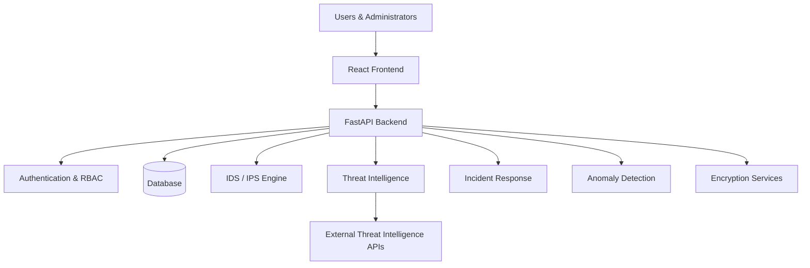

# 🛡️ VERDANT
### Cyber Defense Intelligence Platform

<p align="center">
  <strong>DETECT. PREVENT. RESPOND.</strong>
</p>

<p align="center">
  An integrated cybersecurity platform designed to detect, analyze, prevent, and respond to evolving digital threats through intelligent security monitoring and threat intelligence.
</p>

<p align="center">
  
  
  
</p>

<p align="center">
  <a href="#-about-verdant">About</a> •
  <a href="#-core-capabilities">Features</a> •
  <a href="#-system-architecture">Architecture</a> •
  <a href="#-technology-stack">Tech Stack</a> •
  <a href="#-getting-started">Installation</a> •
  <a href="#-roadmap">Roadmap</a>
</p>

---

## 🌐 About VERDANT

**VERDANT** is a Cyber Defense Intelligence Platform focused on proactive cybersecurity through integrated threat detection, prevention, analysis, and incident response.

As digital infrastructure continues to evolve, cyber threats are becoming increasingly sophisticated. Organizations and individuals need accessible security solutions that can help identify suspicious activities, understand potential risks, and respond to security incidents effectively.

VERDANT aims to address these challenges by bringing essential cybersecurity capabilities together in one centralized platform.

Rather than relying on disconnected security tools, VERDANT is designed to provide a unified environment for monitoring, analyzing, and managing digital security threats.

### Our Mission

To make proactive cybersecurity more accessible through intelligent security technologies, integrated threat intelligence, and practical incident management.

### Our Vision

To develop a scalable and intelligent cyber defense ecosystem that empowers individuals, developers, and organizations to strengthen their digital security.

---

## ⚡ Core Capabilities

VERDANT is built around five primary cybersecurity capabilities.

### 01. Smart IDS / IPS

**Intrusion Detection and Prevention System**

Designed to identify suspicious network activities and potential intrusion attempts.

- Suspicious connection detection.
- Port scanning detection.
- Brute-force activity identification.
- Network activity monitoring.
- Threat event classification.
- Security alerts and detection logs.
- Prevention and response workflows.

### 02. Threat Intelligence

**Know Your Threats Before They Become Incidents.**

An integrated threat intelligence environment for investigating potentially malicious indicators.

- IP reputation lookup.
- Domain reputation analysis.
- URL threat analysis.
- File hash lookup.
- Indicators of Compromise (IOC).
- Threat classification and risk assessment.
- External intelligence integrations.

Planned intelligence sources:
- VirusTotal.
- AbuseIPDB.
- URLhaus.

### 03. Automated Incident Response

**From Detection to Response.**

A centralized incident management system designed to organize and support security response workflows.

- Incident creation and tracking.
- Threat severity classification.
- Investigation timeline.
- Incident assignment.
- Investigation notes.
- Response recommendations.
- Incident status management.
- Audit trail.

### 04. Zero-Day & Anomaly Detection

**Identify What Doesn't Look Normal.**

An anomaly analysis module designed to identify unusual behavioral patterns that may indicate potential security threats.

- Unusual activity detection.
- Behavioral deviation analysis.
- Network anomaly identification.
- Risk scoring.
- Anomaly classification.
- Detection explanations.
- Security event correlation.

*Note: Anomaly detection is not a guarantee of zero-day vulnerability detection. Detection capabilities depend on available data, models, and integrations.*

### 05. Encryption & Data Protection

**Protect What Matters.**

A data protection module providing cryptographic utilities for sensitive information.

- AES-256-GCM encryption.
- Text encryption and decryption.
- File encryption and decryption.
- SHA-256 hashing.
- File integrity verification.
- Secure key handling.

---

## 🖥️ Platform Overview

VERDANT is designed with a centralized dashboard and modular navigation.

| Module | Description |
|---|---|
| Overview | Security dashboard and threat summaries |
| Network Monitoring | Network activity visibility |
| IDS / IPS | Intrusion detection and prevention |
| Threat Intelligence | Threat indicator investigation |
| Incident Response | Security incident management |
| Anomaly Detection | Unusual activity analysis |
| Encryption Center | Data encryption and integrity tools |
| Security Logs | Security event records |
| Reports | Security reporting and analytics |
| Integrations | External security service configuration |
| Account Settings | User and account management |

### User Management

VERDANT is designed to support multi-user access with role-based permissions.

| Role | Access |
|---|---|
| USER | Personal dashboard and security tools |
| ANALYST | Security analysis and incident management |
| ADMIN | User management and system administration |

Authentication features are designed to include:

- User registration.
- Secure login and logout.
- Password reset.
- User profile management.
- Session management.
- Role-Based Access Control (RBAC).
- Account security management.

---

## 🏗️ System Architecture

VERDANT follows a modular client-server architecture.



### Architecture Principles

- **Modularity:** Independent components for easier maintenance and development.
- **Scalability:** Designed to support future expansion.
- **Security:** Authentication, authorization, and secure data handling.
- **Maintainability:** Organized codebase and clear separation of responsibilities.
- **Integration:** Support for external threat intelligence services.

---

## 🛠️ Technology Stack

The following technologies are selected for the planned implementation.

### Frontend

| Technology | Purpose |
|---|---|
| React | User interface |
| TypeScript | Type safety |
| Vite | Development and build tooling |
| Tailwind CSS | Styling |
| shadcn/ui | UI components |
| Lucide React | Icon library |
| Recharts | Data visualization |
| TanStack Query | Server state management |
| React Router | Application routing |

### Backend

| Technology | Purpose |
|---|---|
| Python | Core backend language |
| FastAPI | REST API framework |
| SQLAlchemy | Database ORM |
| Pydantic | Data validation |
| Alembic | Database migrations |

### Database & Security

| Technology | Purpose |
|---|---|
| SQLite | Initial development database |
| PostgreSQL | Production database target |
| Argon2id | Password hashing |
| AES-256-GCM | Symmetric encryption |
| SHA-256 | Cryptographic hashing |

---

## 📁 Project Structure

```text
VERDANT/
│
├── frontend/
│   ├── public/
│   └── src/
│       ├── assets/
│       ├── components/
│       │   ├── ui/
│       │   ├── layout/
│       │   ├── dashboard/
│       │   └── shared/
│       │
│       ├── features/
│       │   ├── auth/
│       │   ├── profile/
│       │   ├── users/
│       │   ├── network/
│       │   ├── ids-ips/
│       │   ├── threat-intelligence/
│       │   ├── incidents/
│       │   ├── anomaly/
│       │   ├── encryption/
│       │   ├── notifications/
│       │   ├── reports/
│       │   └── admin/
│       │
│       ├── hooks/
│       ├── lib/
│       ├── services/
│       ├── types/
│       ├── utils/
│       └── routes/
│
├── backend/
│   ├── app/
│   │   ├── api/
│   │   ├── core/
│   │   ├── database/
│   │   ├── models/
│   │   ├── schemas/
│   │   ├── repositories/
│   │   ├── services/
│   │   ├── engines/
│   │   ├── integrations/
│   │   ├── middleware/
│   │   └── main.py
│   │
│   ├── migrations/
│   ├── tests/
│   └── requirements.txt
│
├── docs/
│   ├── architecture.md
│   ├── database.md
│   ├── api.md
│   ├── installation.md
│   ├── user-guide.md
│   └── security.md
│
├── scripts/
├── storage/
├── .env.example
├── .gitignore
├── docker-compose.yml
└── README.md
```

---

## 🚀 Getting Started

### Prerequisites

Make sure you have installed:

- Node.js (LTS).
- npm.
- Python 3.11+.
- Git.

### 1. Clone the Repository

```bash
git clone <YOUR_REPOSITORY_URL>
cd VERDANT
```

### 2. Backend Setup

```bash
cd backend

python -m venv venv
```

Activate the virtual environment.

**Windows:**

```bash
venv\Scripts\activate
```

**Linux / macOS:**

```bash
source venv/bin/activate
```

Install dependencies:

```bash
pip install -r requirements.txt
```

Configure environment variables using the provided `.env.example`.

Run database migrations using the project's configured Alembic setup:

```bash
alembic upgrade head
```

Start the backend:

```bash
uvicorn app.main:app --reload
```

Backend development server:

```text
http://127.0.0.1:8000
```

API documentation:

```text
http://127.0.0.1:8000/docs
```

### 3. Frontend Setup

Open another terminal:

```bash
cd frontend

npm install
```

Start the development server:

```bash
npm run dev
```

Frontend development server:

```text
http://localhost:5173
```

*Note: These instructions assume the corresponding project files and configuration have been implemented.*

---

## 🔐 Security & Responsible Use

Security is a foundational principle of VERDANT.

The platform is intended to support defensive cybersecurity, authorized security monitoring, and responsible threat analysis.

Key security principles:

- Secure authentication and authorization.
- Password hashing and session protection.
- API key confidentiality.
- Input validation and secure error handling.
- Audit logging.
- Controlled security operations.
- Protection of sensitive user data.

### Responsible Use Policy

VERDANT must only be used for systems, networks, and digital assets that you own or have explicit authorization to assess.

Users are responsible for ensuring that their security testing and monitoring activities comply with applicable laws and regulations.

---

## 🗺️ Roadmap

Our development roadmap focuses on building a functional and extensible cybersecurity platform.

- [ ] Project foundation and architecture.
- [ ] Public landing page.
- [ ] User registration and authentication.
- [ ] Role-Based Access Control.
- [ ] User and administrator dashboards.
- [ ] User management system.
- [ ] Smart IDS / IPS implementation.
- [ ] Threat intelligence integration.
- [ ] Incident response management.
- [ ] Anomaly detection engine.
- [ ] Encryption center.
- [ ] Notification system.
- [ ] Security reporting.
- [ ] Automated testing.
- [ ] Production deployment.

Roadmap items represent development goals and are not claims of completed functionality.

---

## 🤝 Contributing

Contributions, ideas, feedback, and suggestions are welcome.

If you would like to contribute:

1. Fork this repository.
2. Create a feature branch.
3. Implement your changes.
4. Run relevant tests.
5. Submit a Pull Request.

Please keep contributions focused, documented, and aligned with the project's defensive security objectives.

---

## 📌 Project Status

**VERDANT is currently under active development.**

The platform is being developed with an emphasis on practical functionality, modular architecture, security, and user experience.

Some capabilities may initially operate in demonstration mode while their underlying integrations and detection engines are being developed.

Our objective is to progressively transform VERDANT into a functional, integrated cyber defense platform.

---

## 📜 License

VERDANT is intended to be released under the MIT License.

The official LICENSE file will be added following the project's license submission and approval process.
---

## 🌱 Our Philosophy

> Cybersecurity should not begin when an attack succeeds. It should begin with awareness, detection, and prevention.

**VERDANT — Detect. Prevent. Respond.**

Building a smarter approach to digital defense.

---

<p align="center">
  <strong>VERDANT CYBER DEFENSE INTELLIGENCE PLATFORM</strong>
  <br/>
  <sub>Securing the digital landscape through intelligence and prevention.</sub>
  <br/><br/>
  <strong>Made with purpose. Built for defense. 🌱</strong>
</p>
